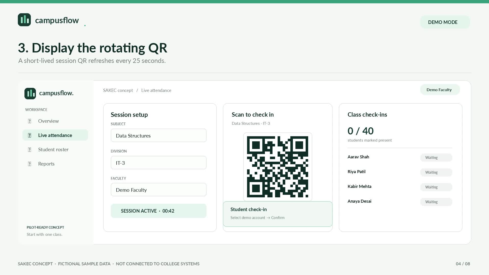

# CampusFlow

**Smarter attendance. Simpler classrooms.**

  

CampusFlow is a student-built prototype exploring a low-cost classroom-attendance workflow: a lecturer starts a session, a time-limited QR code appears, demo students check in from a browser, and the register can be exported as CSV.

> [!IMPORTANT]
> **Prototype / demonstration only.** CampusFlow is an independent student prototype and is not affiliated with or endorsed by any college or institution. It uses fictional sample students and must not be used for official attendance or real student records. The demo student picker is not authentication, and a QR code does not prove physical presence or eliminate proxy attendance.

[](https://github.com/voyager67/Campusflow/blob/main/CampusFlow-Concept-Walkthrough-v0.1.0.mp4)

**[▶ Watch the concept walkthrough (MP4)](https://github.com/voyager67/Campusflow/blob/main/CampusFlow-Concept-Walkthrough-v0.1.0.mp4)** · This is a designed concept walkthrough, not a recording of a live campus deployment. The application can be run locally using the steps below.

## What this release demonstrates

- **Faculty dashboard** — overview, live attendance, roster and report screens.
- **Rotating QR check-in** — random, short-lived session token with a 25-second expiry.
- **Live class count** — check-ins appear in the active session view.
- **Duplicate prevention** — a student can only be recorded once per session.
- **Fictional sample roster** — 40 generated demo students, with no college records imported.
- **Reports** — session history and downloadable attendance CSV.
- **Local persistence** — SQLite database created on first launch.
- **No student app required** — the demo flow runs in a modern browser.

## Quick start

### Requirements

- Python 3.10 or newer
- `pip`
- A modern web browser

### Windows

1. Extract the release ZIP.
2. Open the extracted `campusflow` folder.
3. Double-click `run_windows.bat`.
4. Open **http://127.0.0.1:8000**.

### macOS or Linux

From the project directory, run:

```bash
python3 -m pip install -r requirements.txt
python3 server.py
```

Then open **http://127.0.0.1:8000**.

The server binds to your own computer by default. Keep the terminal open during the demo; press `Ctrl+C` to stop it.

### Optional: scan from a phone on the same Wi-Fi

Phone access is **off by default**. Only enable it on a trusted private network you control.

macOS / Linux:

```bash
CAMPUSFLOW_LAN=1 python3 server.py
```

Windows PowerShell:

```powershell
$env:CAMPUSFLOW_LAN = "1"
python server.py
```

The terminal will print the computer's local-network URL. Open that URL from a phone on the same Wi-Fi and scan the current QR code. Local firewall settings may need adjustment. When finished, stop the server; restart without `CAMPUSFLOW_LAN=1` to return to local-only mode.

To change the port, set `PORT` before starting:

```bash
PORT=8080 python3 server.py
```

Windows PowerShell:

```powershell
$env:PORT = "8080"
python server.py
```

## Try the demo

1. Open **Live attendance** in the sidebar.
2. Choose a subject and start a session.
3. Watch the QR refresh and see the countdown.
4. Select **Simulate a student** to record a fictional demo account. On trusted Wi-Fi, you can instead scan the code from a phone.
5. Try the same account again to see duplicate-check-in rejection.
6. Open **Reports** and export the CSV.

The roster and sample session history are generated in a local SQLite database. That database is intentionally not included in the release archive; it is created on first launch.

## How it works

1. The lecturer starts a demo session.
2. The server creates a random token that is valid for up to 25 seconds; issuing a new token invalidates the previous one.
3. The QR image opens the student check-in page with the session token.
4. The demo student is selected and submitted with the token.
5. The server checks token validity, session status and roster membership, then the database uniqueness constraint rejects duplicate check-ins.
6. Attendance and session data can be reviewed locally and exported to CSV.

**The QR identifies the session, not the person.** The student selector is deliberately demo-only and can be abused. See [Architecture](docs/architecture.md) for the data flow and trust boundaries.

## Project structure

```text
campusflow/
├── .github/                # CI workflow and issue/PR templates
├── assets/                 # Demo walkthrough preview
├── docs/architecture.md    # Components, data flow and trust boundaries
├── docs/DEMO.md            # Presentation walkthrough and stakeholder questions
├── tests/test_smoke.py     # Local API smoke tests
├── app.js                  # Browser interactions
├── index.html              # Faculty dashboard and student flow
├── styles.css              # Responsive interface
├── server.py               # Local server, demo API, QR and SQLite
├── requirements.txt        # QR dependency
├── run_windows.bat         # Windows launcher
├── run_mac_linux.sh        # macOS/Linux launcher
├── SECURITY.md             # Security boundaries and real-pilot prerequisites
├── PITCH_NOTES.md          # Short demo script and pilot discussion guide
├── CHANGELOG.md
├── ROADMAP.md              # Milestones and acceptance criteria
├── LAUNCH_POST.md          # Optional announcement copy
└── README.md
```

## Run the checks

Install the dependency first, then run:

```bash
python -m py_compile server.py tests/test_smoke.py
node --check app.js
python -m unittest discover -s tests -v
```

The tests start an isolated local server with a temporary database; they do not contact SAKEC or use real student records. A GitHub Actions workflow runs these checks for Python 3.10–3.13.

## Security, privacy and limits

CampusFlow is a proof of concept, **not a secure production attendance system**.

- Use fictional demo data only.
- Keep the server local unless you deliberately opt in to a trusted private LAN demo.
- Never expose the unauthenticated demo server directly to the public internet.
- The project has no real student/faculty authentication or production role permissions.
- A short-lived rotating QR and duplicate checks reduce some casual misuse but cannot prove identity or physical presence.
- No gate, face-scanning terminal, portal, LMS, campus network or official attendance system is connected to or modified by this prototype.

Before a real pilot, obtain written institutional approval and complete a qualified security/privacy review. At minimum, a real deployment needs institution-managed authentication, server-side authorisation, secure transport, approved roster integration, auditable corrections, data minimisation, retention and backup rules, monitoring, abuse controls and a tested manual fallback. Read [SECURITY.md](SECURITY.md) before adapting this project.


See [ROADMAP.md](ROADMAP.md) for milestones and acceptance criteria, [docs/DEMO.md](docs/DEMO.md) for the walkthrough, and [PITCH_NOTES.md](PITCH_NOTES.md) for a short college discussion guide.

## Contributing

Focused suggestions and bug reports are welcome. Please use fictional examples only and never submit private student data, credentials or confidential campus-system details. See [CONTRIBUTING.md](CONTRIBUTING.md).


---

**Current release:** `v0.1.0` · **Stage:** early demonstration prototype · **Data:** fictional demo data only
